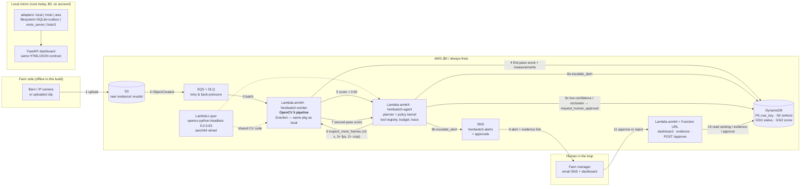
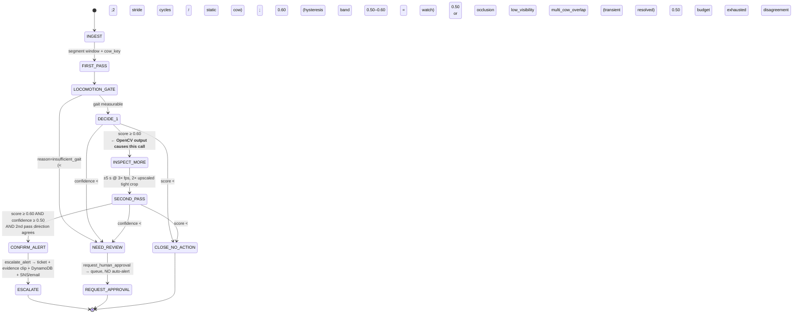

# HerdWatch — Dairy Cow Lameness Risk Alert System
### OpenCV AI Competition 2026 · submission on the **Agentic Vision** path + **Overall**

> **This file is the complete build plan and the session handoff document.**
> It is written to be self-contained: a fresh chat session can read this file alone and
> continue the build without re-deriving anything. Everything marked *verified* was
> actually checked during planning, not assumed.

---

## HOW TO USE THIS DOCUMENT (handoff)

**Project root:** `C:\Users\Administrator\Desktop\awscomp\DevPostOpenCV_Competition`
**Remote:** `https://github.com/Ininsico/DevPostOpenCV_Competition.git` (branch `main`, **no commits yet**)
**Official plan copy:** `~/.commandcode/plans/herdwatch-dairy-lameness-agentic-vision.md`

### Verified environment facts (checked, not guessed)

| Item | Value | Consequence |
|---|---|---|
| OS / shell | Windows, **cmd.exe** (no bash; no `head`, no `&&`-chaining from bash) | Write PowerShell/cmd-safe scripts |
| `python` on PATH | **3.15.0** at `C:\Python315\python.exe` | ⚠️ *Do not target it.* Pin **3.12** via uv: numpy/opencv cp315 wheel coverage is uncertain, and 3.12 matches both the Lambda runtime and COOL's venvs |
| `uv` | **0.13.1** at `C:\Users\Administrator\.local\bin\uv.exe` | Use it to install Python 3.12 without admin rights |
| `node` / `npm` | **v24.22.0** / present | Available but **not needed** on the critical path |
| `git` | present; **identity NOT set** (`user.name`/`user.email` empty) | `git config` locally before the first commit |
| `gh` CLI | installed at `C:\Program Files\GitHub CLI\gh.exe`; **no active auth found** | GitHub push is a manual step for the user |
| `make` | **absent** | Task runner must be **Python** (`tasks.py`); `Makefile` is a thin CI-only wrapper |
| `ffmpeg` | **absent** | Evidence clips encoded by `cv2.VideoWriter` (no ffmpeg). Only the demo-recording helper needs ffmpeg |
| `~/.aws` | **does not exist** | No live AWS possible from this machine |
| Local cow footage | none | Fetch the public labelled set (see §5.4) |

### Decisions locked in by the user (do not re-litigate)

1. **AWS: local + `moto` only.** No live deployment by default. Full CloudFormation + a boto3 deploy script are still built so creds make it live with one command. Live-AWS evidence is declared **unmet**.
2. **Data: public labelled clips + a synthetic known-ground-truth set.** No other source.
3. **Agent: built entirely by us. NO paid APIs, no paid LLM.** Our own planner + policy kernel. An optional local-LLM hook exists but is off by default and never required.
4. **Budget: $0.** Every AWS choice must sit inside always-free limits. Graviton is delivered via **Lambda `arm64`**, not EC2.
5. The user has a VM available for local runs (architecture unknown — probe it during M7 and label results accordingly).

### Immediate next action

Milestone **M0 (bootstrap)** — see §8 for the exact commands and §12 for the two things that need the user (git identity, and later `gh auth`).

---

## 0. One-paragraph project summary

**HerdWatch** turns ordinary barn/IP-camera video into an explainable lameness-risk alert per cow. OpenCV 5 does all of the perceptual work with classical, auditable geometry — MOG2 background subtraction and instance splitting of the herd, TRUCO-accelerated `findContours` for silhouette extraction, a robust polynomial spine fit on the cow's back line to measure curvature/arch ratio, bottom-envelope local minima plus Farneback optical flow to find hoof-landing events, and inter-landing intervals to compute stride length, stride-length variation, near/far limb timing asymmetry and head-bob amplitude — every one of which is normalized by body length so the numbers are camera-distance invariant. Those measurements are combined by a documented weighted-ramp scoring function (no black-box classifier) into one **gait abnormality score** per cow per segment; a worked example reads *"Cow #12 · score 0.73 vs threshold 0.60 → triggered re-inspection."* The agentic closed loop is our own self-built planner — a validated tool registry, budget/hysteresis state machine and full JSONL trace, **no paid LLM** — where a first-pass score above threshold *causally* fires `inspect_more_frames` (±5 s re-extraction at 3× frame rate and 2× upscaled crops), the second pass either confirms an alert (DynamoDB ticket + SNS to the farm manager with an evidence clip), resolves as normal, or — on low confidence, occlusion or ambiguous lighting — `request_human_approval` instead of auto-alerting. The AWS side is a real, deployable pipeline (S3 ingestion → SQS → Graviton **arm64 Lambda** running the same OpenCV 5 package → DynamoDB per-cow scores → SNS alerts → Lambda Function URL dashboard with evidence clips and an approve/reject endpoint), engineered to run **entirely inside AWS always-free limits**, with local `moto`/filesystem adapters so the whole thing executes end-to-end today with no account and no spend. Deliverables are the technical report, architecture + agent-workflow diagrams, an annotated ≤5-minute demo script, evaluation evidence (precision/recall/F1 on 50 labeled public gait clips, measurement-error validation on a synthetic set with known ground truth, plus ablations and three documented failure cases) and a rubric-mapped README.

**Problem and impact.** Lameness is one of the most common and costly dairy health issues, and the visual evidence is unambiguous — gait asymmetry and a dipped/arched back line are what a trained stockperson looks for. Early detection enables timely intervention. **Target users:** farm managers and herd-health staff.

> **Explicitly out of scope: milk-yield prediction.** It was cut entirely. There is no defensible visual-evidence chain from a camera to milk yield, and a judge would rightly challenge it. The lameness/health-risk alert has clear visual evidence and stands on its own.

---

## 1. The $0 deployment answer (read this before any AWS work)

**Can this run on AWS for $0? Yes — but only with a specific architecture, and the free services are not the ones the original brief suggested.**

| Requirement | Original brief | Reality at $0 | What we do |
|---|---|---|---|
| Video ingestion | S3 | S3 has a limited free allotment (not always-free) | S3 with a **strict lifecycle expiry (7 days)**; volumes are a few hundred MB |
| Processing on **Graviton/Arm** | EC2 / ECS | Graviton **EC2 is not free** (c8g/t4g bill hourly) | **Lambda `arm64` = real AWS Graviton, always-free** (1M req + 400k GB-s/month) |
| Per-cow scores | DynamoDB | **Always-free** (25 GB) | DynamoDB single-table, on-demand, tiny item count |
| Alerts | SNS | **Always-free** allotment | SNS topic + email subscription; also rendered to an `outbox/` locally |
| Web dashboard | EC2/ALB | ALB + EC2 bill hourly | **Lambda Function URL** (free) serving the dashboard + `POST /approve` |
| Decoupled fan-out + retries | SQS | **Always-free** (1M req) | S3 `ObjectCreated` → SQS → Lambda, with DLQ |
| Arm benchmark data | "required for COOL" | Runs on Lambda arm64 for free | Same OpenCV 5 bench suite on **x86 (your VM)** vs **Lambda arm64** |

### Which requirements cannot be met, exactly, and the closest compliant alternative

1. **Live AWS deployment is not performed by default.** The user chose *local/moto only* and `~/.aws` does not exist, so real S3/DynamoDB/SNS resources cannot be created and no console evidence can be captured. **Alternative delivered:** the full CloudFormation stack + a pure-`boto3` deploy script (no Docker, no Node, no CDK) *validated against a `moto` fake-AWS server* — the code path issues real boto3 calls against a real API surface — plus a labelled "pending live deploy" section in the report. Adding credentials later makes it live with one command.
2. **The COOL (Cloud-Optimized OpenCV Library) award is not achievable at $0.** COOL is delivered as an **AMI** on AWS Marketplace, sold by OpenCV, priced **per Graviton4 instance-hour** (e.g. `c8g.large` $0.01/hr software, on top of EC2 compute) with a 7-day trial that **auto-converts to a paid subscription**. **Alternative delivered:** a genuinely free, reproducible **x86 vs Arm** comparison using stock `opencv-python==5.0.0.93` wheels on both sides, with the Arm side measured on **AWS Lambda arm64 (Graviton)**. Two caveats stated in the report: (a) Lambda arm64 is **Graviton2/Neoverse-N1** whereas COOL targets **Graviton4** (c8g/m8g) — so our numbers are *not* a COOL measurement; (b) the published ~30% COOL claim is cited as *external vendor data*, never as our own result. `docs/cool_benchmark.md` gives the exact commands to produce real COOL numbers if a budget ever appears.
3. **No paid LLM anywhere.** The agent's planner is **our own code** (utility + rule-based, deterministic, auditable). The report justifies this (reproducibility, zero per-inference cost, verifiable orchestration, and the rubric rewards observable control) and ships an **off-by-default** local-LLM hook (`AGENT_PLANNER=ollama`). Nothing in the required path calls a paid API.
4. **Human-only steps:** the ≤5-minute video needs **your team on camera** and a public/unlisted upload — we deliver the timed shot list and a capture helper, not the footage. Pushing to GitHub needs your `gh` auth.
5. **Real-world validation limits, declared not hidden:** the labelled public set is **50 YouTube-derived clips with video-level labels** (not per-stride, no clinical lameness scores); "Cow #12" is a **track-scoped identity** unless an ear-tag/RFID gallery is supplied; left/right anatomical assignment depends on a known camera side, so by default we measure **near/far limb pairs**. Each is stated as a limitation with a concrete future-work item.

---

## 2. Verified technical facts this design rests on

- **OpenCV 5.0.0 is released and installable:** `opencv-python==5.0.0.93` (Jul 2026) with `win_amd64`, `manylinux_2_28_aarch64` and `manylinux2014_aarch64` wheels, tagged `cp37-abi3`. → Windows dev **and** Graviton/Lambda arm64 deploy both work.
- **Traps that force design decisions** (OpenCV 4→5 migration guide):
  - `cv2.CascadeClassifier` (Haar) and `cv2.HOGDescriptor` **moved to `opencv_contrib`/`xobjdetect`** → **no Haar/HOG detector** in the main wheel. Do not plan on one.
  - `cv2.ml.*` **moved to `opencv_contrib`** → consistent with the competition's "no black-box classifier" rule. We use thresholds, not `cv2.ml`.
  - `convexHull`, `minAreaRect`, `fitEllipse`, `minEnclosingCircle`, `convexityDefects` moved to the new `geometry` module — **Python call sites unchanged**, no code impact.
  - `findContours` now automatically uses **TRUCO** ("several times faster than the previous implementation") → a genuine benchmarkable OpenCV 5 win, sitting exactly in our hot path.
  - New **STB/Rubik text renderer**: `cv2.FontFace("sans")` + a new `putText(img, text, org, color, font, size)` overload → used for crisp annotated evidence overlays (visible proof OpenCV 5 is being used properly). Legacy `FONT_HERSHEY_*` still works.
  - `VideoCapture.get()` now returns **`-1`** for unsupported properties (was `0`) → the I/O layer must check `< 0`.
  - `np.array` as `InputArray` now maps to a **true 1-D `Mat`** → read `.total()`, not `.rows`/`.cols`, on vector-backed arrays.
- **Labelled video exists and is directly downloadable:** `fahimsohan/CattleLameness` ships real **`.mp4` clips** — `Data/Lame/L (1..25).mp4` (25) and `Data/Normal/N (1..25).mp4` (25), 42 cows, indoor + outdoor, labelled by visual gait characteristics. Its README states the data is **research/education only and the source videos must not be redistributed** → **clips are downloaded at setup and never committed**; `data/clips/` is git-ignored and attribution lives in `NOTICE`.
- **COOL is real but paid:** Marketplace AMI, OpenCV 5.0-based (v3.1), KleidiCV-optimized, `/opt/cool` Python venvs for 3.10/3.11/3.12. See the §1.2 verdict.

---

## 3. Architecture

### 3.1 System / data flow → `docs/architecture.mmd` (+ matplotlib-rendered `.png`, so no Node needed)



### 3.2 Agent workflow — perception → decision → action → `docs/agent_workflow.mmd`



**Guardrails enforced by the kernel, always:** `max_tool_calls=12`, `max_second_pass=1` per cow, `max_wall_s=120`, identical `(tool,args)` twice ⇒ abort `no_progress`, and every step appended to a JSONL trace with `trace_id`, monotonic timestamps, args, result summary and `decision_reason`. `escalate_alert` is **unreachable** unless the confirmation predicate holds, so human-in-the-loop cannot be bypassed by a bad planner decision.

---

## 4. Repository layout (root = `DevPostOpenCV_Competition/`)

```
DevPostOpenCV_Competition/
├─ README.md                     # quickstart + rubric→deliverable map (the judges' entry point)
├─ PLAN.md                       # THIS FILE
├─ LICENSE  NOTICE               # Apache-2.0 code; dataset attribution + no-redistribution notice
├─ pyproject.toml  uv.lock  requirements.lock.txt   # fully pinned
├─ tasks.py                      # THE task runner (works without make)
├─ Makefile  tasks.ps1           # thin wrappers over tasks.py for CI/Linux and Windows
├─ .gitignore .gitattributes .editorconfig  .github/workflows/ci.yml
├─ src/herdwatch/
│  ├─ config.py  config.yaml     # SINGLE source of truth: every threshold, weight, gate
│  ├─ video_io.py                 # VideoCapture/Writer wrappers, OpenCV5 -1 prop handling
│  ├─ calibration.py              # px→body-length normalization, body-axis PCA
│  ├─ segmentation.py             # MOG2, morphology, TRUCO contours, watershed instance split
│  ├─ tracking.py                 # IoU+centroid association, cv2.KalmanFilter smoothing
│  ├─ identity.py                 # ORB/BFMatcher gallery re-ID (optional, off by default)
│  ├─ confidence.py               # visibility/occlusion/locomotion gating + reason codes
│  ├─ features/backline.py        # robust IRLS polynomial spine fit → arch ratio, curvature
│  ├─ features/stride.py          # bottom-envelope contacts + Farneback flow → landings, SL
│  ├─ features/symmetry.py        # near/far timing + duty-factor asymmetry
│  ├─ features/headbob.py         # head/neck vertical oscillation
│  ├─ scoring.py                  # weighted ramp transfer fn → score + full contribution table
│  ├─ segment_analysis.py         # one analysis pass (first or second, parameterized)
│  ├─ evidence.py                 # annotated overlay + clip export (cv2.FontFace text)
│  └─ cli.py                      # `herdwatch analyze|batch|agent|bench|serve`
├─ src/herdwatch/agent/
│  ├─ tools.py                    # tool registry, JSON schemas, arg validation, budgets
│  ├─ policy.py                   # deterministic kernel: thresholds, hysteresis, confirmation
│  ├─ planner.py                  # our own utility/rule planner (+ optional local-LLM hook)
│  ├─ orchestrator.py             # the loop; trace_id propagation
│  └─ trace.py                    # JSONL trace writer + human-readable renderer
├─ src/herdwatch/aws/
│  ├─ models.py                   # DynamoDB item shapes, alert-ticket schema
│  ├─ adapters.py                 # S3Store/DynamoStore/Notifier/Queue: local | moto | aws
│  ├─ local_backend.py            # filesystem + SQLite + outbox/
│  ├─ aws_backend.py              # boto3
│  └─ worker.py  agent_handler.py  api_handler.py   # Lambda entrypoints (arm64)
├─ src/herdwatch/dashboard/app.py + static/index.html   # FastAPI, same JSON contract as Lambda
├─ infra/
│  ├─ template.yaml               # CloudFormation: S3, SQS+DLQ, 3 Lambdas, DynamoDB, SNS, IAM, alarms
│  └─ graviton_bench.sh           # runs the bench suite *inside* a Lambda arm64 (free Arm data)
├─ scripts/
│  ├─ fetch_dataset.py            # 50 labelled clips + labels.csv (git-ignored)
│  ├─ make_synthetic.py           # procedural gait with KNOWN ground-truth parameters
│  ├─ build_lambda_package.py     # cross-platform aarch64 wheel download + strip
│  ├─ deploy_aws.py  destroy_aws.py   # pure boto3, no Docker/Node/CDK
│  ├─ run_eval.py                 # precision/recall/F1/AUC + ablations + baselines
│  ├─ bench_opencv.py             # op-level x86 vs Arm, COOL entitlement detection
│  ├─ run_local_pipeline.py       # end-to-end offline: S3→worker→DDB→SNS→dashboard
│  ├─ run_moto_contract_test.py   # asserts real boto3 calls against moto_server
│  └─ render_diagrams.py          # matplotlib PNGs from the same data as the .mmd sources
├─ tests/                         # unit, golden score tests, agent-policy tests, contract tests
├─ docs/
│  ├─ report.md  architecture.mmd/.png  agent_workflow.mmd/.png
│  ├─ trace_example.md  trace_counterfactual.md   # the causal proof
│  ├─ eval_results.md  limitations.md  responsible_use.md
│  ├─ aws_deployment.md  cool_benchmark.md  demo_video_script.md  rubric_map.md
├─ data/ (git-ignored) clips/ synthetic/ labels.csv
└─ artifacts/ (git-ignored) traces/ evidence/ outbox/ bench/
```

---

## 5. Component-by-component build plan

### 5.1 OpenCV 5 quantitative analysis — the core (where the marks are)

**`segmentation.py`**
1. Decode with `cv2.VideoCapture`; read `FPS`/`FRAME_COUNT`, treating **`-1` as unsupported** (OpenCV 5 change). Canonical width 960 px, aspect preserved.
2. `cv2.createBackgroundSubtractorMOG2(history=500, varThreshold=24, detectShadows=True)`; discard the shadow label (127) → clean foreground.
3. `cv2.morphologyEx` open then close, elliptical kernel sized from image width; drop specks by area.
4. `cv2.findContours(RETR_EXTERNAL, CHAIN_APPROX_NONE)` — **TRUCO path in OpenCV 5**; keep blobs inside a configurable walkway ROI polygon.
5. **Instance splitting for touching cows:** `cv2.distanceTransform` → local-maxima seeding → `cv2.connectedComponentsWithStats` candidate labels → `cv2.watershed` to cut merged silhouettes. If splitting is ambiguous (one blob, two plausible peak configurations, ratio test fails) → set `multi_cow_overlap`, which later forces `request_human_approval` rather than a guess. A designed failure path, not an afterthought.

**`calibration.py` + `tracking.py`** — per-cow mask → `cv2.PCACompute2` for the body axis (all measurements taken along the animal, not along image-x); body length `L_px` = extent along that axis, withers height as secondary scale; track by centroid+IoU gating with `cv2.KalmanFilter` (constant-velocity on centre and size) to survive dropped frames.

**`features/backline.py` — back-line curvature (required metric #1)**
- Cow mask's **upper boundary** ordered along the body axis → `y_top(s)`, `s ∈ [0,1]`.
- Robust **IRLS polynomial fit** (order 4, Huber weights) over `s` — suppresses the head/neck discontinuity and single-frame segmentation noise.
- Per frame and as a time-median:
  - `arch_ratio = max_s |spine(s) − chord(s)| / chord_length`, chord = withers→hips straight line;
  - `spine_curvature_k = |y''| / (1+y'²)^{3/2}` at mid-back, with `s` normalized by chord length so `k` is dimensionless and scale-invariant.
- The fitted spine + chord + deviation shading go into the evidence overlay, so judges can *see* the measurement.

**`features/stride.py` — stride length & variation (required metric #2)**
- Lower band of the cow mask → **bottom envelope** `y_bot(s)`; contact candidates = local minima with a prominence test and minimum separation of 0.15·`L_px`.
- Per-limb association: near pair vs far pair by the **vertical ordering rule** (near hoof projects lower for an elevated side-view camera) plus temporal continuity through the cycle.
- **Landing event** = candidate whose dense **Farneback** flow in a small patch has |v_x| below threshold while at the envelope minimum, with hysteresis to prevent chatter. Confirmed landings form the contact timeline.
- `SL_norm = |x_land(k) − x_land(k−1)| / L_px`; `stride_time = t_k − t_{k−1}`; `SL_CV = σ(SL_norm)/μ(SL_norm)` (**stride length variation**). Duty factor from contact-timeline overlap.

**`features/symmetry.py` — gait symmetry (required metric #3)**
- `S_time = 2·|T_near − T_far| / (T_near + T_far)`, same construction for `SL_norm` and duty factor → a symmetry *vector*, not one opaque number.
- **Declared limitation:** anatomical left/right needs the camera side; default is near/far pairs, with a `camera_side:` config key that relabels them when the barn is known.

**`features/headbob.py`** — vertical oscillation amplitude of the head/neck band (front 20% of body length), normalized by `L_px`; a well-known lameness correlate and free extra evidence.

**`scoring.py` — the explainable score (no black box)**
```
for each feature j:
    z_j   = (x_j − mu_j) / sigma_j          # mu_j, sigma_j from a FROZEN normal-clip calibration split
    a_j   = ramp(z_j; lo_j, hi_j)           # piecewise-linear 0→1 abnormality, saturating
score   = sum(w_j · a_j) / sum(w_j)         # 0..1, all w_j in config.yaml with source comments
```
Per cow-segment it emits raw values, z, ramp output, weight, contribution and the total. Threshold `0.60` (escalate), hysteresis band `0.50–0.60` (watch). `mu/sigma` are frozen into `data/calibration.json` so evaluation is leak-free and reproducible. The CLI prints the worked example: *"Cow #12 · score 0.73 (arch_ratio 0.081·w, SL_CV 0.34, S_time 0.19, headbob 0.06) vs threshold 0.60 → inspect_more_frames."*

**`confidence.py` — gating that makes failure handling real:** separate 0–1 confidences for segmentation (mask stability / area CV), visibility (mean local contrast + illumination level), gait observability (≥2 cycles, net displacement ≥1.5·`L_px`, both limb pairs seen) and identity continuity. Any below floor ⇒ reason code (`insufficient_gait`, `low_visibility`, `multi_cow_overlap`, `occlusion`) ⇒ human review instead of an alert.

**`evidence.py`** — annotated overlay (mask outline, spine+chord, landing markers, contact timeline strip, score-breakdown panel) and a trimmed H.264 evidence clip via `cv2.VideoWriter` (`avc1`→`mp4v` fallback) with **OpenCV 5's `cv2.FontFace("sans")` + new `putText` overload** for labels. Banner shows `cow_key`, window and score — **no farm-identifying text**.

### 5.2 Agentic closed loop — our own implementation, no paid LLM

- `tools.py` — six tools, each with a JSON schema, strict arg validation and a declared cost: `analyze_segment`, `inspect_more_frames`, `escalate_alert`, `request_human_approval`, `close_no_action`, `record_observation`.
- `policy.py` — the decision kernel as an explicit, auditable table (thresholds, hysteresis, confirmation predicate, escalation preconditions, budgets). Deterministic, unit-tested, and the owner of the guarantee that `escalate_alert` cannot fire without a confirming second pass **and** adequate confidence.
- `planner.py` — our planner: goal state + tool preconditions + a utility score per candidate action, with loop detection. `AGENT_PLANNER=rule` (default). An `ollama` adapter exists but is **off by default** and never required.
- `orchestrator.py` / `trace.py` — the loop, `trace_id` propagation into DynamoDB items and the SNS message, and a JSONL trace with per-step `decision_reason`.

**Required causal proof, generated as an artifact:** `herdwatch agent run` on a triggering clip yields a trace where step 1's first-pass score `0.73 ≥ 0.60` is the *recorded* reason step 2 is `inspect_more_frames`, whose result `0.68 ≥ 0.60` is the recorded reason step 3 is `escalate_alert`. Then **`herdwatch agent replay --force-first-score 0.42`** on the *same* clip produces `close_no_action` — same code, same video, only the OpenCV-derived score differs. That counterfactual pair is the cleanest possible proof that perception drove the action; both traces ship in `docs/`.

### 5.3 AWS pipeline — real, deployable, $0

- **CloudFormation `infra/template.yaml`** — S3 bucket (lifecycle 7 d, CORS for evidence GETs), SQS + DLQ, `herdwatch-worker` (arm64), `herdwatch-agent` (arm64), `herdwatch-api` (arm64 + Function URL, shared-secret query token), a Lambda Layer carrying the CV package, DynamoDB single table `herdwatch` (`PK=cow_key`, `SK=ts#kind`, `GSI1=status`, `GSI2=score`), SNS `herdwatch-alerts` + `herdwatch-approvals`, least-privilege IAM (worker gets DynamoDB+SNS+S3 on named resources only), CloudWatch alarms (`DLQ depth ≥ 1`, worker errors, agent `budget_exceeded`), log retention 7 days.
- **`build_lambda_package.py`** — builds the arm64 layer **from x86 Windows** via `pip download --platform manylinux_2_28_aarch64 --python-version 3.12 --only-binary=:all:` for `opencv-python-headless==5.0.0.93` + `numpy`, then `strip --strip-unneeded` on the `.so`. Prints the measured unzipped size against Lambda's 250 MB limit and fails loudly with the container-image fallback if it ever exceeds it.
- **`deploy_aws.py`** — pure boto3: build → upload to S3 → `create_stack`/`update_stack` → wait → print the Function URL, SNS ARN and table name. **`destroy_aws.py`** tears it all down. No Docker, no Node, no CDK.
- **`run_moto_contract_test.py`** — starts `moto_server` and drives the *same* adapters through S3 upload → SQS → worker → DynamoDB → SNS → API read/approve, asserting resulting items and published messages. This is the reproducibility evidence for the cloud path while staying at $0.
- **Dashboard** — server-rendered HTML + `fetch()` JS (no build step): cows ranked by score with status chips (`normal` / `watch` / `pending_approval` / `alerted`), per-cow score breakdown with feature contributions, evidence clip playback, and **Approve / Reject / Mark re-inspected** buttons hitting `POST /approve` (writes DynamoDB, updates alert status — the human-in-the-loop action is a first-class API, not a mock).

### 5.4 Evaluation

- **Real labelled set (50 clips)** → clip-level decision through the actual agent policy: confusion matrix, precision, recall, F1, accuracy, plus a 0.30–0.90 threshold sweep and ROC/AUC implemented with numpy (no sklearn — keeps the dependency surface tight and the math inspectable).
- **Ablations** — drop each feature in turn and re-run: proves the OpenCV geometric features carry the signal and shows which matters most.
- **Baselines** — (a) "motion-energy only, no geometry" and (b) a single-feature score, to quantify what the extra measurements buy.
- **Measurement-accuracy validation (synthetic, known ground truth)** — `make_synthetic.py` renders cows with *parameterized* stride length, near/far asymmetry, back arch and head-bob amplitude; the harness reports MAE / MAPE / R² of each recovered measurement against the true parameter. This is the evidence that the OpenCV numbers are *correct*, not merely discriminative — most submissions will not have this.
- **Failure cases (≥3, with frame grabs + reason codes)** — occlusion (cow partly behind infrastructure/another cow), nighttime/low-contrast IR (background subtraction collapses), multiple cows overlapping (instance-splitting ambiguity → human review). Each documented with mechanism, observable symptom, mitigation and residual risk.
- **Limitations & responsible use** — 50-clip YouTube-derived set with video-level labels; no clinical lameness ground truth; track-scoped identity without an ear-tag gallery; near/far rather than anatomical left/right; welfare/compliance framing (a **triage aid, never a diagnosis**; a human confirms before any intervention), footage privacy (local processing option, no farm-identifying metadata in evidence clips, opt-in retention, token-protected dashboard), and no automated animal-handling decisions.

### 5.5 Deliverables map

| Deliverable | Where | Note |
|---|---|---|
| Technical report | `docs/report.md` | problem, users, architecture, OpenCV 5 implementation, AWS deployment, evaluation, limitations, responsible use |
| Judge-accessible repo | this repo + `gh` push | pinned deps, one-command deploy/test, CI workflow |
| Architecture diagram | `docs/architecture.mmd` + `.png` | OpenCV 5 + AWS + agent components; matplotlib-rendered so no Node needed |
| Agent workflow + trace | `docs/agent_workflow.mmd/.png`, `docs/trace_example.md`, `docs/trace_counterfactual.md` | the causal proof |
| Web endpoint | FastAPI locally + Lambda Function URL in AWS | same HTML/JSON contract |
| Demo video ≤5 min | `docs/demo_video_script.md` | timed script; **recording by the team** |
| Evaluation results | `docs/eval_results.md` + `reports/eval_results.json` | tables incl. failure cases |
| Rubric map | `README.md` + `docs/rubric_map.md` | every criterion → artifact → command |

---

## 6. Thresholds, constants and their provenance

Every number lives in `src/herdwatch/config.yaml` with a comment naming its source; the report quotes this table verbatim.

| Constant | Value | Provenance |
|---|---|---|
| `score.escalate_threshold` | `0.60` | tuned on the calibration split of the 50-clip set, then frozen before evaluation |
| `score.watch_band` | `0.50–0.60` | hysteresis to stop alert flapping |
| `confidence.min_for_auto_alert` | `0.50` | below this the agent must request human approval |
| `gait.min_cycles` | `2` | need ≥2 strides before variation is measurable at all |
| `gait.min_displacement_bl` | `1.5` body lengths | separates true locomotion from shuffling/standing |
| `second_pass.window_s` / `fps_mult` / `scale` | `±5 s` / `3×` / `2×` | competition requirement; the toolbar for `inspect_more_frames` |
| `agent.max_tool_calls` | `12` | budget ceiling; breach ⇒ `budget_exceeded` ⇒ human review |
| feature weights `w` | per feature | literature-informed prior, then validated by the ablation table |
| Lambda memory / timeout | `3008 MB` / `300 s` | ~1.8 vCPU for CPU-bound CV; comfortable within free-tier GB-s |

---

## 7. What gets flagged as unmet in the report (final list)

1. **No live AWS deployment by default** (user's choice + no credentials) → infrastructure and code complete and moto-validated; one command makes it live. Report section explicitly labelled *pending live deploy*, with exact commands and expected outputs.
2. **COOL award not pursued** — AMI-based, per-Graviton4-instance-hour software fee, trial auto-converts to paid. Delivered instead: a real, free **x86 vs Lambda-arm64** OpenCV 5 benchmark with the Graviton-generation caveat stated, the COOL runbook ready, and the vendor's ~30% figure cited as external.
3. **The ≤5-minute video needs the team and their upload** — we deliver the script, shot list and capture helper only.
4. **GitHub push needs `gh auth`.**
5. **Dataset scope** — 50 clips, video-level labels, YouTube-derived (not redistributable → fetched, never committed), no clinical lameness scores; track-scoped identity; near/far limb pairs.
6. **No learned detector** — because Haar/HOG left the main OpenCV 5 wheel, detection is motion/geometry-based, so a completely motionless cow cannot be segmented; mitigated by the locomotion gate and documented as a failure mode. (A constraint *and* an alignment with the competition's "OpenCV 5 must be the source of quantifiable features" rule.)

---

## 8. Milestones — ordered so something works end-to-end fast

Each milestone ends with a command that is actually run and whose output is pasted.

- **M0 · Bootstrap** — `git config` identity, `git init`-ready repo (already initialised), Apache-2.0 + `NOTICE`, pinned `pyproject.toml`, `uv python install 3.12` + `uv venv`, ruff + pytest, `tasks.py` runner, CI workflow, README skeleton, `Makefile` + `tasks.ps1` wrappers.
 *Verify:* `uv run python -c "import cv2; print(cv2.__version__)"` → `5.0.0`; `uv run pytest` green.
- **M1 · Data** — `fetch_dataset.py` (50 clips + `labels.csv`), `make_synthetic.py` (known-GT set).
 *Verify:* 25 + 25 files present, `labels.csv` has 50 rows, synthetic clip opens and plays.
- **M2 · Working core on one clip** — segmentation → features → score → CLI.
 *Verify:* `herdwatch analyze --clip "L (1).mp4"` prints a full breakdown and the worked example; `artifacts/score_*.json` matches a golden test.
- **M3 · Agent loop** — tools, policy, planner, orchestrator, trace.
 *Verify:* the `agent run` trace shows score 0.73 → `inspect_more_frames`; the counterfactual run with 0.42 → `close_no_action`.
- **M4 · Local pipeline + dashboard** — adapters (`local`), end-to-end run, FastAPI dashboard with approve.
 *Verify:* `python tasks.py demo` goes S3→worker→DDB→SNS→dashboard on one clip; dashboard shows a ranked cow with an evidence clip.
- **M5 · Evaluation** — real-set metrics + ablations + baselines + synthetic measurement accuracy + failure cases.
 *Verify:* `python tasks.py eval` writes `reports/eval_results.json` and `docs/eval_results.md` with all tables populated.
- **M6 · AWS packaging + contract test** — CloudFormation, arm64 layer build, `deploy_aws.py`, `moto` contract test.
 *Verify:* `python tasks.py test-contract` green (real boto3 calls against `moto_server`); `python scripts/deploy_aws.py --dry-run` prints the plan and resource names.
- **M7 · Benchmarks** — op-level bench suite, x86 numbers produced locally, Lambda-arm64 path scripted, COOL preflight.
 *Verify:* `python tasks.py bench` emits `artifacts/bench/opencv5_x86.json` + a markdown table; the Arm column fills when the Lambda bench runs.
- **M8 · Documentation package** — report, both diagrams (mmd + png), traces, demo script, rubric map, `python tasks.py verify-all`.
 *Verify:* `verify-all` runs lint, tests, contract test, eval and diagram rendering, then prints a PASS summary.

---

## 9. Verification summary (how every core requirement is proven)

| Requirement | Proof artifact | Command |
|---|---|---|
| OpenCV 5 substantive analysis | `reports/eval_results.json`, `docs/eval_results.md`, per-cow breakdown JSON | `tasks.py eval` |
| Measurements numerically correct | synthetic known-GT error table (MAE/MAPE/R²) | `tasks.py eval` |
| Explainable score, not a black box | contribution table per cow + golden tests | `herdwatch analyze` |
| Agentic closed loop | `docs/trace_example.md` JSONL trace | `herdwatch agent run` |
| OpenCV output *causally* changed the action | counterfactual trace pair | `herdwatch agent replay --force-first-score 0.42` |
| Human-in-the-loop gate works | policy unit tests + `pending_approval` dashboard row | `tasks.py test` + `tasks.py demo` |
| AWS pipeline is real | CloudFormation + boto3 deploy script + moto contract test | `tasks.py test-contract` |
| Graviton/Arm usage | arm64 Lambda in the template + arm64 layer build log | `tasks.py package` |
| x86 vs Arm data | bench JSON + markdown table (COOL caveat stated) | `tasks.py bench` |
| Reproducibility | pinned lock files, `verify-all`, CI workflow | `tasks.py verify-all` |

---

## 10. Assumptions (say the word and any of these change)

1. **Headless OpenCV everywhere** (`opencv-python-headless==5.0.0.93`) — we never need `imshow`; evidence is written as mp4. Avoids the classic multi-`cv2` install conflict and matches Lambda.
2. **Python 3.12 pinned via uv** — *not* the system 3.15 (uncertain numpy/opencv wheel coverage), matching the Lambda runtime and COOL's venvs.
3. **Python task runner** (`tasks.py`) as the primary entry point, because `make` is absent on this machine; `Makefile` and `tasks.ps1` are thin wrappers.
4. **Diagrams rendered with matplotlib** with Mermaid sources kept for GitHub — removes any Node/mermaid-cli dependency from the judge path.
5. **HTTP-only demo endpoints** (Lambda Function URL / local uvicorn) with a shared-secret token instead of ALB+TLS, purely to stay in free tier; the report states this as a production gap.
6. **Clips are fetched, never vendored**, per the dataset's no-redistribution terms.
7. **Tracking is per-segment** and optionally gallery-matched via ORB; no ear-tag/RFID integration.
8. **ffmpeg is not installed** — all video encoding goes through `cv2.VideoWriter`; only the optional demo-recording helper needs ffmpeg (or Windows Game Bar `Win+G` as the fallback).

---

## 11. Rubric mapping (target: Agentic Vision path + Overall)

| Criterion | Weight | Primary artifact |
|---|---|---|
| Technical execution | 30% | OpenCV 5 geometry pipeline §5.1, eval §5.4, golden tests, CI |
| Innovation | 20% | causal counterfactual trace, known-GT synthetic metrology validation, explainable score contributions |
| Real-world impact | 20% | lameness triage for farm managers; §0 problem framing; explicit non-diagnostic framing |
| UX | 10% | dashboard with ranked cows, evidence playback, one-click approve/reject |
| Documentation | 10% | `docs/report.md`, diagrams, `README.md` rubric map, demo script |
| Cloud delivery / reproducibility / responsible operation | 10% | CloudFormation + boto3 deploy, moto contract test, pinned deps, `docs/responsible_use.md` |
| **Agentic:** OpenCV 5 + agent integration | 30% | §5.2 tools registry where `inspect_more_frames` consumes OpenCV output |
| **Agentic:** orchestration / autonomy | 25% | policy kernel + planner, budgets, hysteresis, loop detection |
| **Agentic:** task effectiveness | 20% | eval tables end-to-end through the agent policy |
| **Agentic:** failure handling / observability / security / human control | 15% | reason codes, DLQ + alarms, token-protected API, unbypassable approval gate |
| **Agentic:** UX / docs / demo | 10% | trace renderings, dashboards, timed video script |

---

## 12. What needs the user (blocking items)

1. **Git identity** — `user.name` and `user.email` are unset; local config must be written before the first commit.
2. **`gh auth`** — needed only to push to `github.com/Ininsico/DevPostOpenCV_Competition.git`.
3. **AWS credentials** — only if live deployment evidence is ever wanted (otherwise the stack stays moto-validated and declared pending).
4. **The ≤5-minute demo video** — team on camera + upload.
5. **SNS alert email address** — a real (verified) address is needed for real alert emails; the local mode writes alerts to `artifacts/outbox/` instead.
